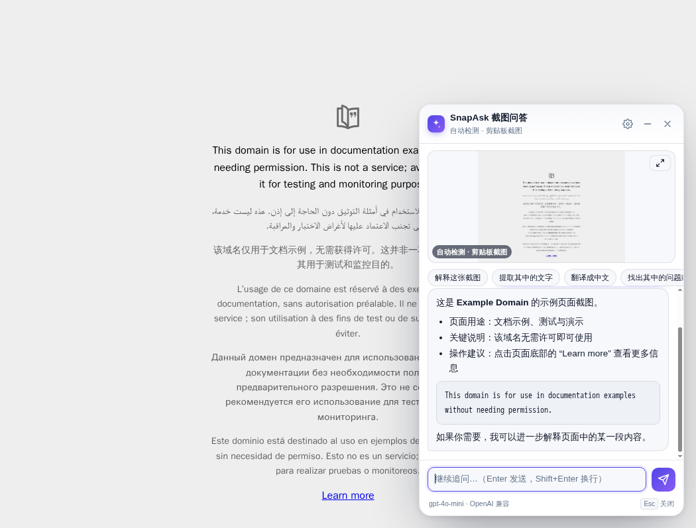
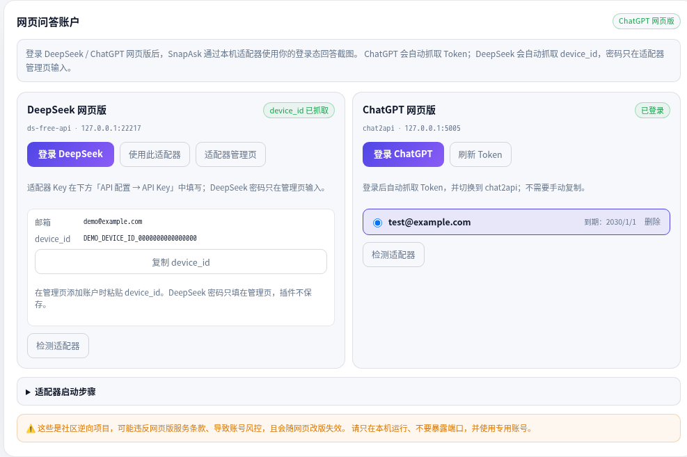

<div align="center">
  
  <h1>SnapAsk 截图问答</h1>
  <p><b>截图即问，AI 自动弹出解答。</b></p>
  <p>Chrome / Edge 109+ · Manifest V3 · 无中转服务器</p>
  <p>
    
    
    
  </p>
</div>

---

## 功能

- **自动检测截图**：剪贴板出现新图片时自动弹出面板并提问。
- **三种截图入口**：系统截图进剪贴板、`Alt+Shift+S` 截当前页、`Alt+Shift+X` 框选。
- **流式回答**：Markdown、追问、复制、停止、重试、最小化。
- **多种后端**：GPT / DeepSeek / GLM / Claude / Gemini / 本地 Ollama，以及 DeepSeek / ChatGPT 网页版。
- **网页账户可视化登录**：ChatGPT 自动抓 Token；DeepSeek 自动抓 device_id。
- **隐私友好**：截图不落盘、Key 不下发内容脚本、面板使用 closed Shadow DOM、错误自动脱敏。

## 截图





## 安装

### 方式一：下载 Release（推荐）

1. 下载 [snapask-extension-v1.0.1.zip](https://github.com/liku-yu/SnapAsk/releases/download/v1.0.1/snapask-extension-v1.0.1.zip)。
2. 解压到一个**固定目录**，例如 `~/Applications/SnapAsk` 或 `C:\SnapAsk`。
3. 打开 `chrome://extensions/` 或 `edge://extensions/`，开启开发者模式。
4. 点击 **加载已解压的扩展程序**，选择**直接包含 `manifest.json` 的文件夹**。

> 不能直接选择 `.zip`；解压后的文件夹也不要删除或移动，否则扩展会失效。

### 方式二：从源码加载

1. 克隆本仓库，或下载源码。
2. 打开 `chrome://extensions/` 或 `edge://extensions/`，开启开发者模式。
3. 点击 **加载已解压的扩展程序**，选择仓库根目录。
4. 打开设置页，配置 API 或网页账户。

首次安装会自动打开设置页。

## 使用

- **系统截图**：Windows `Win+Shift+S`；macOS `⌘+Ctrl+Shift+4`（注意要带 `Ctrl`，否则只会保存到桌面）。
- **浏览器内**：`Alt+Shift+S` 截当前页，`Alt+Shift+X` 框选。
- **右键菜单**：网页空白处右键 → SnapAsk。
- 快捷键可在 `chrome://extensions/shortcuts`（Edge 为 `edge://extensions/shortcuts`）修改。

## 网页问答（无需官方 API Key）

用 DeepSeek / ChatGPT 网页版回答截图，需要在本机运行一个开源适配器：

| 网页版 | 适配器 | 默认地址 | 登录方式 |
| --- | --- | --- | --- |
| DeepSeek | [ds-free-api](https://github.com/NIyueeE/ds-free-api) | `127.0.0.1:22217/v1` | 插件登录 → 自动抓 device_id；在适配器管理页绑定账户 |
| ChatGPT | [chat2api](https://github.com/lanqian528/chat2api) | `127.0.0.1:5005/v1` | 插件登录 → 自动抓 Token，直接可用 |

设置页的 **网页问答账户**：

- **ChatGPT**：点击“登录 ChatGPT”，登录完成后自动抓取 Token；账户出现在列表中，点击即可切换，支持多账户、删除、刷新 Token。
- **DeepSeek**：点击“登录 DeepSeek”，登录完成后自动抓取 device_id；复制到 ds-free-api 管理页添加账户。DeepSeek 密码只填在管理页，**不经过插件、不保存**。
- 两个卡片都有“检测适配器”和“适配器管理页”入口。

详细步骤、安全提示和排错见 **[WEB-QA.md](WEB-QA.md)**。

> ⚠️ ds-free-api / chat2api 是社区逆向项目，可能违反网页版服务条款、导致账号风控，且会随网页改版失效。请只在本机运行、不要暴露端口，并使用专用账号。

## API 配置

| 服务 | 接口类型 | Base URL | 模型示例 |
| --- | --- | --- | --- |
| OpenAI (GPT) | OpenAI 兼容 | `https://api.openai.com/v1` | `gpt-4o-mini` |
| DeepSeek | OpenAI 兼容 | `https://api.deepseek.com` | `deepseek-flash` |
| 智谱 GLM | OpenAI 兼容 | `https://open.bigmodel.cn/api/paas/v4` | `glm-4.5v` |
| Anthropic Claude | Anthropic | `https://api.anthropic.com/v1` | `claude-3-5-sonnet-latest` |
| Google Gemini | OpenAI 兼容 | `https://generativelanguage.googleapis.com/v1beta/openai` | `gemini-2.0-flash` |
| 本地 Ollama | OpenAI 兼容 | `http://localhost:11434/v1` | `qwen2.5vl:7b` |

Base URL 填服务商的 OpenAI 兼容地址，插件会自动补 `/chat/completions` 或 `/messages`。模型必须支持图片输入；DeepSeek 截图请用 `deepseek-flash`，`deepseek-v4-pro` 是纯文本。本地 `localhost` 服务可以留空 API Key。

## 工作原理

```
截图 / 剪贴板
   → offscreen 监听 → background 压缩
   → 当前页面 Shadow DOM 面板 → 自动提问
   → API / 本机网页适配器 → SSE 流式回答
```

- 截图只在内存/DOM 中，不写入 `chrome.storage`。
- 完整 API Key 只由 background 使用；内容脚本/弹窗/独立窗口只拿到 `hasApiKey` 布尔值。
- 网页内面板使用 closed Shadow DOM，页面 JS 无法读取截图和回答。
- 错误信息会移除 Key、Bearer、JWT、`sk-` 等敏感模式。

## 权限

| 权限 | 用途 |
| --- | --- |
| `storage` | 设置、账户、去重哈希 |
| `scripting` | 注入面板、抓取 device_id |
| `offscreen` | 监听剪贴板截图 |
| `clipboardRead` / `clipboardWrite` | 读取截图 / 复制回答和 device_id |
| `contextMenus` | 右键截图入口 |
| `<all_urls>` | 在任意网页显示面板；请求任意 API/本机适配器 |

## 已知限制

1. 截图必须进入剪贴板；只保存到文件的截图无法检测。
2. 连续复制完全相同的图片不会重复触发，重新截同一画面请用快捷键。
3. 面板打开时做系统截图，面板会被截入；可最小化或开启“回答后自动收起”。
4. `chrome://`、扩展商店等页面无法注入，会改用独立窗口。
5. 网页适配器是逆向项目，可能失效或触发账号风控；DeepSeek 网页端独立 vision 模式已下线，识图效果需实测。
6. 追问会重复发送历史与截图，长对话 token 消耗会增加。

## 开发

```bash
npm run check                  # JS 语法检查
npm run build                  # 打包到 dist/
npm run mock                   # 本地 OpenAI 兼容 mock
npm run icons                  # 生成图标
```

测试脚本：`test/mock-api.js`（本地 mock）、`test/cdp.mjs`（CDP 调试辅助）。

仓库元数据（description/topics）：`GITHUB_TOKEN=... ./tools/set-repo-metadata.sh`。

```text
manifest.json
src/
  background/background.js     # 截图 / API / 消息路由
  content/content.js           # 页面面板、框选
  content/web-login.js         # ChatGPT / DeepSeek 登录助手
  shared/ui.js                 # 面板 UI（内容脚本 + viewer 复用）
  offscreen/                   # 剪贴板监听
  popup/                       # 工具栏弹窗
  options/                     # 设置页
  viewer/                      # 受限页面独立窗口
assets/icons/                  # 扩展图标
test/                          # mock API / CDP 辅助
tools/                         # 图标生成 / 仓库元数据
```

## 调研

**没有找到同时满足“自动检测截图 + 自动弹窗 + 自动提问 + 可接自有 API”的现成插件**。网页版接入选择 ds-free-api / chat2api，而不是在扩展内做易碎的 DOM 自动化。详见 [RESEARCH.md](RESEARCH.md)。

## 隐私

不收集统计或账号信息；截图只发送到你配置的 API 或本机适配器；API Key / Token 保存在本机，不经过 SnapAsk 服务器。详见 [PRIVACY.md](PRIVACY.md)。

## License

[MIT](LICENSE)
